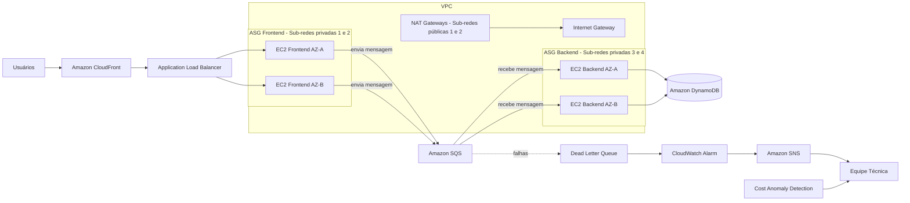

# Semana de Arquitetura AWS — Escola da Nuvem

Projeto prático de três dias para construir, do zero, uma arquitetura web de 3 camadas na AWS: segura, escalável e resiliente.


---

## Sumário

- [Visão Geral](#visão-geral)
- [O Desafio](#o-desafio)
- [Arquitetura Final](#arquitetura-final)
- [Serviços Utilizados](#serviços-utilizados)
- [Cronograma](#cronograma)
- [Fluxo da Requisição](#fluxo-da-requisição)
- [Pré-requisitos](#pré-requisitos)
- [Estrutura do Repositório](#estrutura-do-repositório)
- [Resultados Esperados](#resultados-esperados)
- [Limpeza de Recursos](#limpeza-de-recursos)

---

## Visão Geral

| Item | Descrição |
|------|-----------|
| **Formato** | Evento prático de 3 dias, foco em construção no Console AWS |
| **Público** | Quem já possui conta AWS e conhecimento intermediário do Console de Gerenciamento |
| **Objetivo** | Construir uma arquitetura de 3 camadas segura, escalável e resiliente |

## O Desafio

Construir uma aplicação web de **3 camadas** (frontend, backend e banco de dados) que receba e processe requisições de usuários de forma **desacoplada**, sem que falhas em uma parte comprometam o todo.

O desacoplamento é feito com **Amazon SQS**: o frontend publica mensagens na fila e o backend as consome de forma independente.

## Arquitetura Final



Componentes transversais: **Systems Manager** (Run Command, Session Manager e Parameter Store).

A rede é distribuída em **duas Zonas de Disponibilidade**, cada uma com uma sub-rede pública (NAT Gateway) e duas sub-redes privadas (frontend e backend).

## Serviços Utilizados

| Camada | Serviço | Função |
|--------|---------|--------|
| Apresentação | Amazon CloudFront | Entrega de conteúdo otimizada e ponto único de entrada |
| Apresentação | Application Load Balancer | Distribui o tráfego entre as instâncias de frontend |
| Aplicação | Amazon EC2 + Auto Scaling Groups | Frontend (hospeda o site) e backend (processa requisições) |
| Mensageria | Amazon SQS + DLQ | Desacoplamento entre camadas; nenhuma mensagem perdida em falhas |
| Persistência | Amazon DynamoDB | Armazenamento persistente das requisições |
| Configuração | SSM Parameter Store | Remove segredos do código (URL da fila, nome da tabela) |
| Acesso | SSM Session Manager | Acesso às instâncias sem abrir a porta SSH |
| Observabilidade | Amazon CloudWatch | Dashboard com métricas de ALB, ASGs e SQS; alarmes |
| Alertas | Amazon SNS | Notificações por e-mail |
| Custos | AWS Cost Anomaly Detection | Alerta de anomalias de custo |
| Rede | VPC, Internet Gateway, NAT Gateway | Isolamento em sub-redes públicas e privadas |

## Cronograma

| Dia | Tema | Documentação |
|-----|------|--------------|
| 1 | Construindo a Base | [Dia 1](docs/dia-1/README.md) (concluído) |
| 2 | Segurança e Escalabilidade | [Dia 2](docs/dia-2/README.md) |
| 3 | Observabilidade e Operação | [Dia 3](docs/dia-3/README.md) |

### Dia 1 — Construindo a Base

Guia completo: [docs/dia-1/README.md](docs/dia-1/README.md)

- [x] Instâncias EC2: 2 de frontend e 2 de backend
- [x] Application Load Balancer na frente do frontend
- [x] Tabela Amazon DynamoDB
- [x] Fila Amazon SQS para receber as requisições do frontend

### Dia 2 — Segurança e Escalabilidade

Guia completo: [docs/dia-2/README.md](docs/dia-2/README.md)

- [ ] Parameter Store para remover segredos do código
- [ ] Session Manager para acesso sem SSH
- [ ] Launch Templates e Auto Scaling Groups para frontend e backend
- [ ] CloudFront e Dead Letter Queue (DLQ)

### Dia 3 — Observabilidade e Operação

A arquitetura já existe; o foco é operá-la: monitorar, provocar falhas, corrigir lacunas e garantir resiliência de dados e custo.

Guia completo: [docs/dia-3/README.md](docs/dia-3/README.md)

- [ ] CloudWatch Dashboard unificado
- [ ] Restringir o acesso ao ALB somente via CloudFront
- [ ] Alertas por e-mail com SNS
- [ ] Escalabilidade do backend por backlog de mensagens SQS por instância (não por CPU)
- [ ] Point-in-Time Recovery no DynamoDB
- [ ] Cost Anomaly Detection

## Fluxo da Requisição

1. O usuário acessa a aplicação pelo **CloudFront**.
2. O CloudFront encaminha para o **ALB**, que distribui entre as instâncias de **frontend**.
3. O frontend publica a requisição como mensagem no **SQS**.
4. As instâncias de **backend** consomem a fila e gravam no **DynamoDB**.
5. Mensagens que falham repetidamente vão para a **DLQ**, que dispara um alarme no **CloudWatch** e notifica a equipe via **SNS**.

## Pré-requisitos

- Conta AWS ativa com permissões administrativas
- Conhecimento intermediário do Console de Gerenciamento da AWS
- Noções de redes (VPC, sub-redes, Security Groups)

> **Atenção a custos:** NAT Gateways, ALB, CloudFront e instâncias EC2 geram cobrança. Configure um alerta de orçamento antes de começar.

## Estrutura do Repositório

```
edn-aws-architecture-week/
├── README.md
└── docs/
    ├── dia-1/
    │   ├── README.md          # guia completo do laboratório
    │   ├── img/               # diagramas antes e depois
    │   └── scripts/
    │       ├── frontend.sh    # user data das instâncias de frontend
    │       └── backend.sh     # user data das instâncias de backend
    ├── dia-2/
    │   ├── README.md          # guia completo do laboratório
    │   └── scripts/
    │       ├── frontend.sh    # user data do Launch Template de frontend (lê o Parameter Store)
    │       └── backend.sh     # user data do Launch Template de backend (lê o Parameter Store)
    └── dia-3/
        ├── README.md          # guia completo do laboratório
        └── scripts/
            └── metrica-backlog.json  # métrica de backlog por instância (target tracking)
```

## Resultados Esperados

| Resultado | Descrição |
|-----------|-----------|
| Arquitetura funcional | Aplicação web completa rodando na AWS, construída do zero |
| Segurança reforçada | Zero segredos no código e acesso sem SSH aberto |
| Alta disponibilidade | Instâncias substituídas automaticamente em caso de falha |
| Escalabilidade real | Frontend e backend ajustados à demanda em tempo real |

## Limpeza de Recursos

Ao final, remova os recursos para evitar cobranças, preferencialmente nesta ordem:

1. Distribuição CloudFront (desabilitar e excluir)
2. Auto Scaling Groups e Launch Templates
3. Application Load Balancer e Target Groups
4. Filas SQS (principal e DLQ)
5. Tabela DynamoDB
6. NAT Gateways e Elastic IPs
7. VPC, alarmes do CloudWatch, tópico SNS e parâmetros do Parameter Store

---

Projeto desenvolvido durante a **Semana de Arquitetura AWS** da [Escola da Nuvem](https://escoladanuvem.org).
