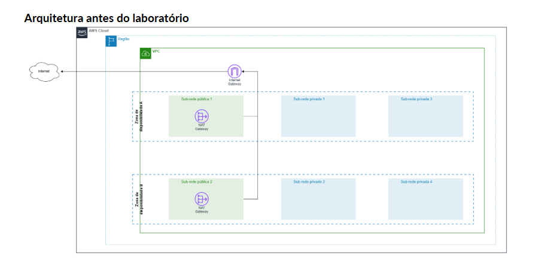
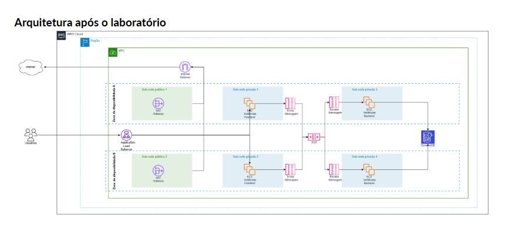
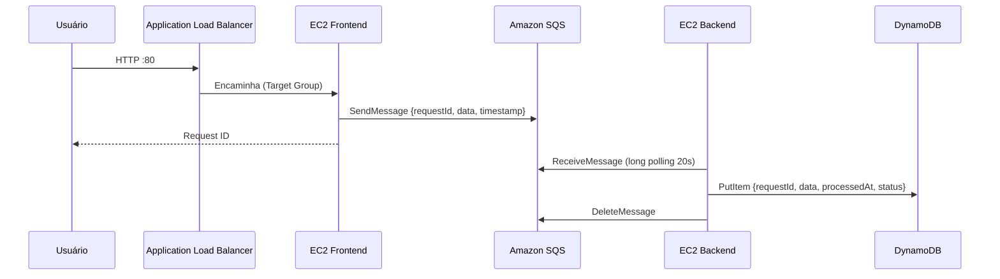

# Dia 1 — Construindo a Base

[Voltar ao README principal](../../README.md)

Criação de uma arquitetura de 3 camadas com **EC2**, **Application Load Balancer**, **Amazon SQS** e **Amazon DynamoDB**. O frontend recebe as requisições dos usuários e as envia para uma fila. O backend consome essa fila e grava os dados no banco.

Este padrão é comum em aplicações legadas, em processamentos que levam vários minutos e em cenários que exigem maior controle sobre a aplicação.

---

## Sumário

1. [Cenário](#cenário)
2. [Arquitetura](#arquitetura)
3. [Pré-requisitos](#pré-requisitos)
4. [Objetivos](#objetivos)
5. [Recursos criados](#recursos-criados)
6. [Passo a passo](#passo-a-passo)
   - [1. Tabela DynamoDB](#1-tabela-dynamodb)
   - [2. Fila SQS](#2-fila-sqs)
   - [3. Security Groups](#3-security-groups)
   - [4. IAM Role](#4-iam-role)
   - [5. Instâncias de frontend](#5-instâncias-de-frontend)
   - [6. Target Group](#6-target-group)
   - [7. Application Load Balancer](#7-application-load-balancer)
   - [8. Instâncias de backend](#8-instâncias-de-backend)
7. [Validação](#validação)
8. [Preparação para o Dia 2](#preparação-para-o-dia-2)
9. [Solução de problemas](#solução-de-problemas)

---

## Cenário

Como responsável pelas decisões de arquitetura de nuvem da empresa, a missão é hospedar uma aplicação web de 3 camadas (frontend, backend e banco de dados) escalável, resiliente e segura, aplicando boas práticas de banco de dados, mensageria e computação.

## Arquitetura

### Antes do laboratório

A VPC já existe, com 2 sub-redes públicas (cada uma com um NAT Gateway), 4 sub-redes privadas vazias e um Internet Gateway, distribuídos em duas Zonas de Disponibilidade.

### Após o laboratório

| Sub-rede | Zona | Recurso |
|----------|------|---------|
| public1 / public2 | A / B | Application Load Balancer, NAT Gateway |
| private1 | A | `frontend1` |
| private2 | B | `frontend2` |
| private3 | A | `backend1` |
| private4 | B | `backend2` |

### Fluxo da requisição

## Pré-requisitos

- Conta AWS ativa, com permissões no IAM para EC2, ELB, SQS e DynamoDB
- VPC `projeto-vpc` com 2 sub-redes públicas e 4 privadas em duas Zonas de Disponibilidade
- NAT Gateway (de preferência regional) e Internet Gateway já configurados
- Editor de texto para ajustar os scripts `.sh` (ex.: VS Code)
- Navegador atualizado (recomendado: Firefox ou Chrome, para acessar o site via HTTP)

## Objetivos

- [ ] Criar a tabela DynamoDB para armazenamento das requisições
- [ ] Criar a fila SQS para receber as requisições do frontend
- [ ] Criar os Security Groups do ALB e das instâncias EC2
- [ ] Criar a IAM Role das instâncias EC2
- [ ] Iniciar 2 instâncias EC2 de frontend
- [ ] Criar o Target Group com as instâncias de frontend
- [ ] Criar o Application Load Balancer
- [ ] Iniciar 2 instâncias EC2 de backend
- [ ] Testar a aplicação pelo DNS do ALB

## Recursos criados

Substitua `<nome>` pelo seu nome e sobrenome, usando apenas letras minúsculas, números, pontos e hífens.

| Recurso | Nome | Configuração principal |
|---------|------|------------------------|
| Tabela DynamoDB | `tabela-registros-<nome>` | Chave de partição `requestId` (String) |
| Fila SQS | `fila-registros-<nome>` | Tipo Padrão |
| Security Group (ALB) | `loadbalancer-sg-<nome>` | Entrada HTTP 80 de `0.0.0.0/0` |
| Security Group (EC2) | `ec2-sg-<nome>` | Entrada HTTP 80 somente do `loadbalancer-sg` |
| IAM Role | `ec2-role-<nome>` | `AmazonDynamoDBFullAccess`, `AmazonSQSFullAccess` |
| EC2 Frontend | `frontend1-<nome>`, `frontend2-<nome>` | Amazon Linux 2023, t2.micro, [frontend.sh](scripts/frontend.sh) |
| Target Group | `grupo-frontend-<nome>` | HTTP 80, health check `/`, intervalo 10s |
| Application Load Balancer | `projeto-alb-<nome>` | Voltado para a internet, sub-redes públicas |
| EC2 Backend | `backend1-<nome>`, `backend2-<nome>` | Amazon Linux 2023, t2.micro, [backend.sh](scripts/backend.sh) |

> Anote o **nome da tabela**, a **URL da fila** e o **DNS do ALB**. Eles serão usados nos scripts e nos testes.

---

## Passo a passo

### 1. Tabela DynamoDB

O banco de dados é criado primeiro porque não depende de nenhum outro recurso.

1. Console AWS > **DynamoDB** > **Tabelas** > **Criar tabela**.
2. Configure:
   - Nome da tabela: `tabela-registros-<nome>`
   - Chave de partição: `requestId`, tipo **String**
3. Mantenha as demais opções e clique em **Criar tabela**. A criação pode levar alguns minutos.

### 2. Fila SQS

A fila desacopla o frontend do backend. Se o backend falhar, as requisições continuam guardadas na fila e nada se perde.

1. Console AWS > **SQS** > **Filas** > **Criar fila**.
2. Configure:
   - Tipo: **Padrão**
   - Nome: `fila-registros-<nome>`
3. Mantenha as demais opções e clique em **Criar fila**.
4. Nos detalhes da fila, copie e anote a **URL**.

### 3. Security Groups

Console AWS > **EC2** > **Rede e segurança** > **Security groups** > **Criar grupo de segurança**.

**Load Balancer**

| Campo | Valor |
|-------|-------|
| Nome | `loadbalancer-sg-<nome>` |
| Descrição | Grupo de seguranca para Elastic Load Balancer |
| VPC | `projeto-vpc` (não use a VPC padrão) |
| Regra de entrada | HTTP, origem personalizada `0.0.0.0/0` |

**Instâncias EC2**

| Campo | Valor |
|-------|-------|
| Nome | `ec2-sg-<nome>` |
| Descrição | Grupo de seguranca para EC2 |
| VPC | `projeto-vpc` |
| Regra de entrada | HTTP, origem personalizada: o Security Group `loadbalancer-sg-<nome>` |

Com isso, as instâncias só recebem tráfego que passa pelo Load Balancer.

### 4. IAM Role

1. Console AWS > **IAM** > **Funções** > **Criar perfil**.
2. Tipo de entidade confiável: **Serviço da AWS**. Caso de uso: **EC2**.
3. Políticas: `AmazonDynamoDBFullAccess` e `AmazonSQSFullAccess`.
4. Nome da função: `ec2-role-<nome>` > **Criar perfil**.

Com a role, a instância recebe da AWS credenciais temporárias. Assim, nenhuma Access Key ou Secret Key precisa ficar gravada na EC2.

### 5. Instâncias de frontend

Console AWS > **EC2** > **Instâncias** > **Executar instâncias**. Repita para as duas instâncias:

| Campo | `frontend1` | `frontend2` |
|-------|-------------|-------------|
| Nome | `frontend1-<nome>` | `frontend2-<nome>` |
| AMI | Amazon Linux 2023 | Amazon Linux 2023 |
| Tipo | t2.micro | t2.micro |
| Par de chaves | Prosseguir sem par de chaves | Prosseguir sem par de chaves |
| VPC | `projeto-vpc` | `projeto-vpc` |
| Sub-rede | `private1` | `private2` |
| IP público automático | Desabilitar | Desabilitar |
| Security Group | `ec2-sg-<nome>` | `ec2-sg-<nome>` |
| Perfil de instância IAM | `ec2-role-<nome>` | `ec2-role-<nome>` |
| Dados do usuário | [frontend.sh](scripts/frontend.sh) | [frontend.sh](scripts/frontend.sh) |

Antes de colar o script no campo **Dados do usuário** (em **Detalhes avançados**), substitua:

- `<SUA_REGIAO>` pela região do laboratório (ex.: `us-west-1`)
- `<URL_DA_FILA_SQS>` pela URL anotada no passo 2

A aplicação Flask escuta na porta 80 e roda como serviço do systemd (`frontend-app.service`).

### 6. Target Group

Console AWS > **EC2** > **Balanceamento de carga** > **Grupos de destino** > **Criar grupo de destino**.

| Campo | Valor |
|-------|-------|
| Tipo de destino | Instâncias |
| Nome | `grupo-frontend-<nome>` |
| Protocolo / Porta | HTTP / 80 |
| Tipo de endereço IP | IPv4 |
| VPC | `projeto-vpc` |
| Versão do protocolo | HTTP1 |
| Health check | HTTP, caminho `/` |
| Intervalo (avançado) | 10 segundos |

Em **Registrar destinos**, selecione as duas instâncias de frontend e clique em **Incluir como pendente abaixo**. Depois, clique em **Criar grupo de destino**.

### 7. Application Load Balancer

Console AWS > **EC2** > **Load balancers** > **Criar load balancer** > **Application Load Balancer**.

| Campo | Valor |
|-------|-------|
| Nome | `projeto-alb-<nome>` |
| Esquema | Voltado para a Internet |
| Tipo de endereço IP | IPv4 |
| VPC | `projeto-vpc` |
| Sub-redes | `public1` e `public2` |
| Security Group | `loadbalancer-sg-<nome>` |
| Listener | HTTP 80 > Encaminhar para `grupo-frontend-<nome>` (peso 1) |

Após a criação, copie o **Nome do DNS** do ALB. Aguarde de 1 a 2 minutos e confira no Target Group se os dois destinos aparecem como **Healthy**.

Teste o frontend:

1. Acesse `http://<DNS-do-ALB>` no navegador.
2. Digite um texto e clique em **Submit Request**. A página exibe o Request ID.
3. Em **SQS**, confirme que a fila tem **1 mensagem disponível**.

### 8. Instâncias de backend

Siga o mesmo processo do passo 5, alterando os valores abaixo:

| Campo | `backend1` | `backend2` |
|-------|------------|------------|
| Nome | `backend1-<nome>` | `backend2-<nome>` |
| Sub-rede | `private3` | `private4` |
| Dados do usuário | [backend.sh](scripts/backend.sh) | [backend.sh](scripts/backend.sh) |

No script, substitua:

- `<SUA_REGIAO>` pela região do laboratório (nas duas linhas: cliente do SQS e do DynamoDB)
- `<URL_DA_FILA_SQS>` pela URL da fila
- `<NOME_DA_TABELA_DYNAMODB>` pelo nome da tabela

O worker roda como serviço do systemd (`backend-worker.service`). Ele consulta a fila com long polling de 20 segundos, grava cada mensagem no DynamoDB e só depois a remove da fila.

---

## Validação

| Verificação | Resultado esperado |
|-------------|--------------------|
| Target Group | 2 destinos **Healthy** |
| Página `http://<DNS-do-ALB>` | Formulário "Frontend Web Application" carregado |
| Envio de requisição | Mensagem de sucesso com Request ID |
| Fila SQS após o backend iniciar | 0 mensagens disponíveis |
| DynamoDB > Explorar itens | Itens com `requestId`, `data`, `processedAt` e `status = processed` |

Envie mais 1 ou 2 requisições pela página e confirme que elas aparecem na tabela.

## Preparação para o Dia 2

| Instância | Ação |
|-----------|------|
| `frontend2-<nome>`, `backend2-<nome>` | **Encerrar** (excluir) |
| `frontend1-<nome>`, `backend1-<nome>` | **Interromper** (serão reutilizadas) |

Mantenha a tabela, a fila, os Security Groups, a IAM Role, o Target Group e o ALB.

## Solução de problemas

| Sintoma | Causa provável |
|---------|----------------|
| Destinos **Unhealthy** no Target Group | O `ec2-sg` não permite HTTP vindo do `loadbalancer-sg`, ou a instância está sem Security Group |
| Página não abre | Use `http://` em vez de `https://`. Alguns navegadores bloqueiam acesso via HTTP |
| Erro ao enviar requisição | Região ou URL da fila incorretas no `frontend.sh`, ou IAM Role não associada à instância |
| Mensagens acumulando na fila | Região, URL da fila ou nome da tabela incorretos no `backend.sh` |
| Instância sem acesso aos pacotes ou à AWS | Sub-rede privada sem rota para o NAT Gateway |
