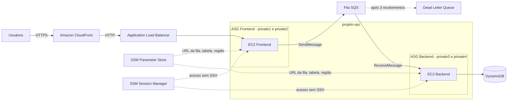

# Dia 2 — Segurança e Escalabilidade

[Voltar ao README principal](../../README.md) · [Dia 1](../dia-1/README.md)

Evolução da arquitetura do Dia 1. Os valores de configuração saem do código e vão para o **Parameter Store**. O acesso às instâncias passa a ser feito pelo **Session Manager**. As instâncias fixas são substituídas por **Auto Scaling Groups**, o **CloudFront** passa a ser a porta de entrada e uma **Dead Letter Queue** guarda as mensagens que falham.

---

## Sumário

1. [Problemas a resolver](#problemas-a-resolver)
2. [Arquitetura](#arquitetura)
3. [Pré-requisitos](#pré-requisitos)
4. [Objetivos](#objetivos)
5. [Recursos criados](#recursos-criados)
6. [Passo a passo](#passo-a-passo)
   - [1. Parâmetros no Parameter Store](#1-parâmetros-no-parameter-store)
   - [2. Permissões da IAM Role](#2-permissões-da-iam-role)
   - [3. Acesso pelo Session Manager](#3-acesso-pelo-session-manager)
   - [4. Código do frontend](#4-código-do-frontend)
   - [5. Código do backend](#5-código-do-backend)
   - [6. Teste da aplicação](#6-teste-da-aplicação)
   - [7. Launch Templates](#7-launch-templates)
   - [8. Auto Scaling Group do frontend](#8-auto-scaling-group-do-frontend)
   - [9. Auto Scaling Group do backend](#9-auto-scaling-group-do-backend)
   - [10. Distribuição CloudFront](#10-distribuição-cloudfront)
   - [11. Dead Letter Queue](#11-dead-letter-queue)
   - [12. Teste da DLQ](#12-teste-da-dlq)
7. [Validação](#validação)
8. [Desafio opcional](#desafio-opcional)

---

## Problemas a resolver

| Problema no Dia 1 | Solução no Dia 2 |
|-------------------|------------------|
| URL da fila e nome da tabela escritos no código | Parameter Store |
| Mudar um recurso exige editar e reimplantar cada instância | Parameter Store + Launch Templates |
| Instância que cai não volta sozinha | Auto Scaling Groups com health check do ELB |
| Acesso administrativo dependeria de SSH | Session Manager, sem porta 22 e sem IP público |
| Mensagem com falha fica sendo reprocessada sem fim | Dead Letter Queue |
| Usuário distante acessa direto o ALB da região | CloudFront com HTTPS |

## Arquitetura



## Pré-requisitos

- Recursos do [Dia 1](../dia-1/README.md) criados: tabela, fila, Security Groups, IAM Role, Target Group e ALB
- Instâncias `frontend1-<nome>` e `backend1-<nome>` interrompidas (serão ligadas no passo 3)
- Editor de texto para ajustar os scripts `.sh`

## Objetivos

- [ ] Criar os parâmetros no Parameter Store
- [ ] Adicionar as permissões do Systems Manager à IAM Role
- [ ] Acessar as instâncias pelo Session Manager
- [ ] Atualizar o código do frontend e do backend para ler o Parameter Store
- [ ] Criar os Launch Templates de frontend e backend
- [ ] Criar os Auto Scaling Groups de frontend e backend
- [ ] Criar a distribuição CloudFront
- [ ] Criar a Dead Letter Queue e testar uma falha
- [ ] (Desafio) Restringir o acesso ao ALB somente via CloudFront

## Recursos criados

Substitua `<nome>` pelo seu nome e sobrenome, usando apenas letras minúsculas, números, pontos e hífens.

| Recurso | Nome | Configuração principal |
|---------|------|------------------------|
| Parâmetro | `/projeto/<nome>/region` | String, região do laboratório |
| Parâmetro | `/projeto/<nome>/sqs/queue-url` | String, URL da fila |
| Parâmetro | `/projeto/<nome>/dynamodb/table-name` | String, nome da tabela |
| IAM Role (alteração) | `ec2-role-<nome>` | + `AmazonSSMManagedInstanceCore`, `AmazonSSMReadOnlyAccess` |
| Launch Template | `Frontend-<nome>` | Amazon Linux 2023, t2.micro, [frontend.sh](scripts/frontend.sh) |
| Launch Template | `Backend-<nome>` | Amazon Linux 2023, t2.micro, [backend.sh](scripts/backend.sh) |
| Auto Scaling Group | `asg-frontend-<nome>` | private1/private2, min 1, max 2, CPU 60%, `grupo-frontend-<nome>` |
| Auto Scaling Group | `asg-backend-<nome>` | private3/private4, min 1, max 2, CPU 60%, sem ELB |
| CloudFront | `CloudFront-<nome>` | Origem: ALB, HTTP only, sem WAF |
| Fila SQS (DLQ) | `dlq-registros-<nome>` | Retenção 14 dias, visibilidade 30s |

---

## Passo a passo

### 1. Parâmetros no Parameter Store

Os valores de configuração ficam em um só lugar. Para trocar a fila ou a tabela, basta editar o parâmetro, sem mexer no código.

1. Console AWS > **Systems Manager** > **Ferramentas de aplicação** > **Parameter Store**.
2. Clique em **Criar parâmetro** e crie os três abaixo, todos com nível **Padrão** e tipo **String**:

| Nome | Valor (exemplo) |
|------|-----------------|
| `/projeto/<nome>/region` | `us-east-1` |
| `/projeto/<nome>/sqs/queue-url` | `https://sqs.us-east-1.amazonaws.com/123456789012/fila-registros-<nome>` |
| `/projeto/<nome>/dynamodb/table-name` | `tabela-registros-<nome>` |

> Anote os nomes exatamente como foram criados: o código usa esses caminhos.

O tipo **String** padrão é gratuito. Para valores sensíveis, como senhas, o ideal é **SecureString** (criptografado com KMS). O laboratório não usa SecureString para evitar o custo do KMS.

### 2. Permissões da IAM Role

1. Console AWS > **IAM** > **Funções** > `ec2-role-<nome>`.
2. **Adicionar permissões** > **Anexar políticas**.
3. Marque e anexe:

| Política | Para que serve |
|----------|----------------|
| `AmazonSSMManagedInstanceCore` | Permite que o agente SSM da instância se comunique com o Systems Manager (necessária para o Session Manager) |
| `AmazonSSMReadOnlyAccess` | Permite ler os parâmetros do Parameter Store |

Sem essas políticas, tanto o acesso remoto quanto a leitura dos parâmetros falham com acesso negado.

### 3. Acesso pelo Session Manager

1. Em **EC2**, inicie as instâncias `frontend1-<nome>` e `backend1-<nome>`.
2. Console AWS > **Systems Manager** > **Ferramentas de nós** > **Gerenciador de sessões** > **Iniciar sessão**.
3. Em **Instâncias de destino**, selecione `frontend1-<nome>` e clique em **Iniciar sessão**.

> Se a instância não aparecer, aguarde 2 minutos (propagação da política IAM) ou reinicie a instância.

O Session Manager abre um terminal na instância pela API da AWS, autenticado pelo IAM. Por isso as instâncias foram criadas sem par de chaves e sem IP público: nenhuma porta SSH precisa ficar aberta.

### 4. Código do frontend

Na sessão do `frontend1-<nome>`:

```bash
pip3 install flask
sudo nano /opt/frontend-app/app.py
```

Substitua todo o conteúdo pelo trecho Python do [frontend.sh](scripts/frontend.sh) (entre `cat > /opt/frontend-app/app.py << 'EOF'` e o `EOF` seguinte), trocando:

- `<SUA_REGIAO>` pela região do laboratório
- `<NOME>` pelo nome usado nos parâmetros

Atalhos do nano: **Ctrl+Shift+↓** até o fim e **Ctrl+K** para recortar tudo; cole com o botão direito; **Ctrl+O**, **Enter** e **Ctrl+X** para salvar e sair.

```bash
sudo systemctl restart frontend-app.service
sudo systemctl status frontend-app.service
```

O resultado esperado é `Active: active (running)`.

A diferença em relação ao Dia 1: `QUEUE_URL` não está mais no código. Ele é lido com `get_parameter('/projeto/<nome>/sqs/queue-url')`.

### 5. Código do backend

No Session Manager, inicie uma sessão no `backend1-<nome>`:

```bash
sudo nano /opt/backend-worker/worker.py
```

Substitua todo o conteúdo pelo trecho Python do [backend.sh](scripts/backend.sh), com as mesmas trocas de `<SUA_REGIAO>` e `<NOME>`.

```bash
sudo systemctl restart backend-worker.service
sudo systemctl status backend-worker.service
```

O worker usa **long polling** (`WaitTimeSeconds=20`): espera até 20 segundos por mensagens em vez de consultar a fila a todo segundo, o que reduz custo e tráfego. O `VisibilityTimeout=30` deixa a mensagem invisível para outros consumidores por 30 segundos. Se ela não for apagada nesse tempo, volta para a fila. Esse comportamento é a base da DLQ.

### 6. Teste da aplicação

1. Acesse `http://<DNS-do-ALB>` e envie um texto.
2. Em **SQS**, a mensagem aparece e some rapidamente.
3. Em **DynamoDB** > **Explorar itens da tabela**, o item aparece com `status = processed`.

### 7. Launch Templates

O Launch Template é o modelo que o Auto Scaling usa para criar instâncias sozinho.

> **Antes de continuar, encerre as instâncias `frontend1-<nome>` e `backend1-<nome>`.** A partir daqui, quem cria as instâncias é o Auto Scaling.

Console AWS > **EC2** > **Instâncias** > **Modelos de execução** > **Criar modelo de execução**.

| Campo | Frontend | Backend |
|-------|----------|---------|
| Nome do modelo | `Frontend-<nome>` | `Backend-<nome>` |
| AMI | Amazon Linux 2023 (aba **Início rápido**) | Amazon Linux 2023 |
| Tipo de instância | t2.micro | t2.micro |
| Par de chaves | Não incluir no modelo | Não incluir no modelo |
| Security Group | `ec2-sg-<nome>` | `ec2-sg-<nome>` |
| Perfil de instância IAM (Detalhes avançados) | `ec2-role-<nome>` | `ec2-role-<nome>` |
| Dados do usuário (Detalhes avançados) | [frontend.sh](scripts/frontend.sh) | [backend.sh](scripts/backend.sh) |

Nos dois scripts, substitua `<SUA_REGIAO>` e `<NOME>` antes de colar.

> Os scripts deste repositório não seguem a numeração de linhas do PDF. Localize os marcadores com Ctrl+F. Agora os scripts não contêm mais a URL da fila nem o ID da conta: só a região e o seu nome.

### 8. Auto Scaling Group do frontend

Console AWS > **EC2** > **Auto Scaling** > **Grupos do Auto Scaling** > **Criar grupo do Auto Scaling**.

| Campo | Valor |
|-------|-------|
| Nome | `asg-frontend-<nome>` |
| Modelo de execução | `Frontend-<nome>` |
| VPC | `projeto-vpc` |
| Sub-redes | `private1` e `private2` |
| Balanceamento de carga | Anexar a um balanceador de carga existente |
| Grupo de destino | `grupo-frontend-<nome>` |
| Verificações de integridade | Ativar verificações do Elastic Load Balancing |
| Capacidade desejada / mínima / máxima | 1 / 1 / 2 |
| Ajuste de escala | Política com monitoramento do objetivo |
| Nome da política | `Escalabilidade CPU Frontend-<nome>` |
| Métrica / valor | Média de utilização da CPU / 60 |
| Etiqueta | `Name` = `asg-frontend-<nome>`, marcar **Etiquetar novas instâncias** |

O grupo mantém de 1 a 2 instâncias em duas Zonas de Disponibilidade. Com o health check do ELB, uma instância que falha no Target Group é substituída. A política de CPU tenta manter o uso médio perto de 60%: cria uma instância quando a carga sobe e remove quando cai.

### 9. Auto Scaling Group do backend

Mesmo processo do passo 8, com estas diferenças:

| Campo | Valor |
|-------|-------|
| Nome | `asg-backend-<nome>` |
| Modelo de execução | `Backend-<nome>` |
| Sub-redes | `private3` e `private4` |
| Balanceamento de carga | Nenhum balanceador de carga |
| Nome da política | `Escalabilidade CPU Backend-<nome>` |
| Etiqueta | `Name` = `asg-backend-<nome>` |

Depois que as instâncias subirem, teste o site pelo DNS do ALB.

### 10. Distribuição CloudFront

O CloudFront entrega a aplicação a partir de locais próximos ao usuário e já oferece HTTPS.

Console AWS > **CloudFront** > **Distributions** > **Create distribution**.

| Campo | Valor |
|-------|-------|
| Plano | Pay as you go |
| Distribution name | `CloudFront-<nome>` |
| Distribution type | Single website or app |
| Origin type | Elastic Load Balancer |
| Origin | DNS do `projeto-alb-<nome>` |
| Settings | Customize origin settings |
| Protocol | HTTP only |
| WAF | Do not enable security protections |

O usuário fala com o CloudFront por HTTPS, e o CloudFront fala com o ALB por HTTP, que é o listener configurado no Dia 1.

Aguarde o status sair de **Deploying**. Copie o **Distribution domain name** (algo como `d1234567890.cloudfront.net`) e acesse em uma nova aba: a página abre com HTTPS.

### 11. Dead Letter Queue

A DLQ é uma fila SQS comum. Ela vira DLQ quando é associada à fila principal como destino das mensagens que falham várias vezes.

1. Console AWS > **SQS** > **Criar fila**:

| Campo | Valor |
|-------|-------|
| Tipo | Padrão |
| Nome | `dlq-registros-<nome>` |
| Período de retenção | 14 dias |
| Tempo limite de visibilidade | 30 segundos |

2. Na DLQ criada, copie o **ARN**.
3. Abra `fila-registros-<nome>` > **Editar** > **Fila de mensagens mortas**:
   - **Habilitado**
   - Escolher fila: ARN da DLQ
   - Número máximo de recebimentos: **3**
4. **Salvar**.

| Configuração | Efeito |
|--------------|--------|
| Retenção de 14 dias | Mensagens com problema ficam disponíveis para análise |
| Visibilidade de 30s | Uma mensagem em processamento não é entregue a outro consumidor, evitando duplicidade |
| Máximo de recebimentos = 3 | Depois de 3 tentativas sem sucesso, a mensagem vai para a DLQ |

### 12. Teste da DLQ

Simulação de falha do backend. Deixe três abas abertas: **EC2**, **SQS** e o **site**.

1. **SQS:** abra `fila-registros-<nome>` > **Enviar e receber mensagens** e desça até **Receber mensagens**.
2. **EC2:** selecione a instância do backend (`asg-backend-<nome>`) > **Estado da instância** > **Interromper**.
3. **Site:** envie o texto `teste-sqs-dlq`.
4. **SQS:** clique em **Pesquisar mensagens**. A mensagem aparece e, a cada 30 segundos, volta a ficar visível. Use **Interromper sondagem** e **Pesquisar mensagens** para consultar quando quiser.

   > Cada pesquisa no console também conta como recebimento. Por isso a mensagem chega à DLQ mesmo sem nenhum backend rodando.

5. Depois do 3º recebimento, a mensagem some da fila principal.
6. **DLQ:** abra `dlq-registros-<nome>` > **Enviar e receber mensagens** > **Pesquisar mensagens**. A mensagem está lá: nada foi perdido.
7. **EC2:** confirme que o Auto Scaling detectou a instância interrompida e criou uma nova. Aguarde ela ficar pronta.
8. **DLQ:** volte à página da DLQ > **Iniciar redirecionamento da DLQ**. Em **Inspecionar mensagens**, clique em **Pesquisar mensagens**, selecione as mensagens e clique em **Redirecionamento da DLQ**. Elas voltam para a fila principal e são processadas pelo novo backend.

---

## Validação

| Verificação | Resultado esperado |
|-------------|--------------------|
| Parameter Store | 3 parâmetros em `/projeto/<nome>/` |
| Session Manager | Sessão aberta nas instâncias sem SSH |
| Auto Scaling Groups | 1 instância **InService** em cada grupo |
| Target Group | Instância do ASG de frontend **Healthy** |
| `https://<dominio>.cloudfront.net` | Formulário carregado via HTTPS |
| Envio de requisição | Item gravado no DynamoDB |
| Teste da DLQ | Mensagem chega à DLQ e, após o redirecionamento, é gravada no DynamoDB |
| Backend interrompido | O Auto Scaling cria uma instância nova |

## Desafio opcional

### O desafio

A aplicação ainda pode ser acessada direto pelo DNS do ALB, sem passar pelo CloudFront. O objetivo é permitir o acesso **somente pelo CloudFront**, bloqueando o acesso direto ao Load Balancer.

### Solução

A regra de entrada do Security Group do ALB deixa de aceitar `0.0.0.0/0` e passa a aceitar só os IPs do CloudFront. A AWS mantém esses IPs atualizados em uma *managed prefix list*.

1. Console AWS > **EC2** > **Load balancers** > `projeto-alb-<nome>` > aba **Segurança** > clique no ID do Security Group (`loadbalancer-sg-<nome>`).
2. **Regras de entrada** > **Editar regras de entrada**.
3. Confira que a regra é **HTTP 80** com origem **`0.0.0.0/0`**. Se a origem for outro `sg-...`, você abriu o `ec2-sg-<nome>`: cancele e volte ao passo 1.
4. Clique em **Excluir** nessa regra.
5. Clique em **Adicionar regra**:

| Campo | Valor |
|-------|-------|
| Tipo | HTTP |
| Tipo de origem | Personalizado |
| Origem | digite `cloudfront` e selecione `com.amazonaws.global.cloudfront.origin-facing` (a opção **sem** `ipv6`) |
| Descrição | `Somente CloudFront` |

6. **Salvar regras**.

> **Erro "Você não pode especificar listas de prefixos para uma regra CIDR IPv4 existente":** uma regra criada com IP não pode ser convertida em regra de prefix list. Exclua a regra e crie uma nova (passos 4 e 5).
>
> **Erro de limite de regras:** a prefix list conta como várias regras no Security Group. Remova regras de entrada que sobraram nesse grupo.

### Validação

| Teste | Resultado esperado |
|-------|--------------------|
| `https://<dominio>.cloudfront.net` | Página abre normalmente |
| `http://<DNS-do-ALB>` | Fica carregando até dar timeout |
| Envio de texto pelo CloudFront | Item gravado no DynamoDB |

### Limitação

A prefix list libera qualquer distribuição CloudFront, inclusive de outras contas. Para garantir que só a **sua** distribuição chegue ao ALB, adicione um cabeçalho secreto:

1. **CloudFront** > distribuição > **Origens** > ALB > **Editar** > **Adicionar cabeçalho personalizado**: `X-Origin-Verify` com um valor aleatório longo.
2. **ALB** > **Listeners** > **HTTP:80**:
   - Ação padrão: **Retornar resposta fixa**, código **403**.
   - Nova regra: *se* o cabeçalho `X-Origin-Verify` for igual ao valor, *então* encaminhar para `grupo-frontend-<nome>`.

O [Dia 3](../dia-3/README.md) aplica a prefix list como parte do roteiro; o cabeçalho secreto segue como reforço opcional.
