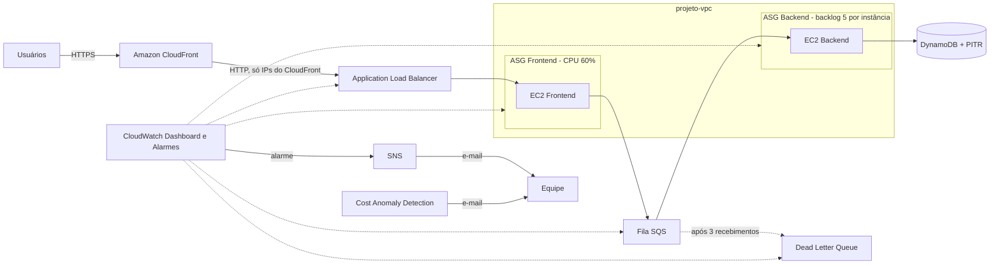

# Dia 3 — Observabilidade e Operação

[Voltar ao README principal](../../README.md) · [Dia 1](../dia-1/README.md) · [Dia 2](../dia-2/README.md)

A arquitetura já existe, já escala e já se recupera da queda de uma instância. Hoje quase nada novo é criado: o foco é **operar** o que existe. As métricas vão para um **dashboard no CloudWatch**, as falhas são provocadas de propósito e os alertas chegam por **e-mail via SNS**. O backend passa a escalar pelo **backlog da fila**, o ALB fica acessível **somente pelo CloudFront**, o DynamoDB ganha **backup contínuo** e os custos passam a ser vigiados pelo **Cost Anomaly Detection**.

---

## Sumário

1. [Problemas a resolver](#problemas-a-resolver)
2. [Arquitetura](#arquitetura)
3. [Pré-requisitos](#pré-requisitos)
4. [Objetivos](#objetivos)
5. [Recursos criados](#recursos-criados)
6. [Passo a passo](#passo-a-passo)
   - [1. Dashboard no CloudWatch](#1-dashboard-no-cloudwatch)
   - [2. Métricas de grupo do Auto Scaling](#2-métricas-de-grupo-do-auto-scaling)
   - [3. Widgets de Auto Scaling e SQS](#3-widgets-de-auto-scaling-e-sqs)
   - [4. ALB somente via CloudFront](#4-alb-somente-via-cloudfront)
   - [5. Tópico SNS](#5-tópico-sns)
   - [6. Alarme de CPU do frontend](#6-alarme-de-cpu-do-frontend)
   - [7. Alarme da DLQ](#7-alarme-da-dlq)
   - [8. Escalabilidade do backend por backlog](#8-escalabilidade-do-backend-por-backlog)
   - [9. Teste de carga no backend](#9-teste-de-carga-no-backend)
   - [10. Teste da DLQ com alarme](#10-teste-da-dlq-com-alarme)
   - [11. Teste de CPU no frontend](#11-teste-de-cpu-no-frontend)
   - [12. Point-in-Time Recovery no DynamoDB](#12-point-in-time-recovery-no-dynamodb)
   - [13. Cost Anomaly Detection](#13-cost-anomaly-detection)
7. [Validação](#validação)
8. [Limpeza](#limpeza)

---

## Problemas a resolver

| Problema no Dia 2 | Solução no Dia 3 |
|-------------------|------------------|
| Só dá para ver o estado da arquitetura abrindo cada serviço | Dashboard no CloudWatch |
| ALB acessível direto pela internet, sem passar pelo CloudFront | Security Group com a prefix list do CloudFront |
| Ninguém fica sabendo de um problema sem olhar o console | Alarmes do CloudWatch + e-mail via SNS |
| Backend escala por CPU, mas o trabalho dele é a fila | Target tracking pelo backlog por instância |
| DynamoDB sem nenhum backup | Point-in-Time Recovery |
| Gasto fora do padrão passa despercebido | AWS Cost Anomaly Detection |

## Arquitetura



## Pré-requisitos

- Recursos do [Dia 2](../dia-2/README.md) ativos: `projeto-alb-<nome>`, `asg-frontend-<nome>`, `asg-backend-<nome>`, `fila-registros-<nome>`, `dlq-registros-<nome>`, `tabela-registros-<nome>`, distribuição CloudFront e parâmetros em `/projeto/<nome>/`
- Acesso a um e-mail para confirmar a assinatura do SNS

## Objetivos

- [ ] Criar um dashboard no CloudWatch com métricas do ALB, dos ASGs e do SQS
- [ ] Restringir o acesso ao ALB somente via CloudFront
- [ ] Criar um tópico SNS e receber alertas por e-mail
- [ ] Escalar o backend pelo backlog de mensagens por instância
- [ ] Provocar e observar falhas de capacidade e de processamento
- [ ] Habilitar Point-in-Time Recovery no DynamoDB
- [ ] Criar um monitor de anomalias de custo

## Recursos criados

Substitua `<nome>` pelo seu nome e sobrenome, usando apenas letras minúsculas, números, pontos e hífens.

| Recurso | Nome | Configuração principal |
|---------|------|------------------------|
| CloudWatch Dashboard | `Dashboard-Arquitetura-<nome>` | 6 widgets: ALB, Target Group, CPU, instâncias, backlog SQS, idade da mensagem |
| Security Group (alteração) | `loadbalancer-sg-<nome>` | HTTP 80 somente da prefix list `com.amazonaws.global.cloudfront.origin-facing` |
| Tópico SNS | `alertas-<nome>` | Padrão, assinatura por e-mail |
| Alarme | `alarm-cpu-frontend-<nome>` | CPU média do `asg-frontend-<nome>` >= 60%, período 5 min |
| Alarme | `alarm-dlq-<nome>` | Mensagens visíveis na DLQ >= 1, máximo, período 1 min |
| Política de escalabilidade | `SQS-Backlog-Backend-<nome>` | Target tracking, métrica `m1 / m2`, alvo 5 |
| DynamoDB (alteração) | `tabela-registros-<nome>` | PITR ativado, período de 1 dia |
| Monitor de custo | `Anomaly-lab-<nome>` | Gerenciado pela AWS, dimensão Serviços |
| Assinatura de alerta | `AnomalyAlerta-<nome>` | Resumo diário, limite de 10% acima do esperado |

---

## Passo a passo

### 1. Dashboard no CloudWatch

O CloudWatch já recebe métricas de EC2, ALB, Auto Scaling e SQS sem configuração extra. O dashboard reúne tudo num painel só, como o painel de um carro: você não abre o motor para saber a velocidade.

1. Console AWS > **CloudWatch** > **Painéis** > **Criar painel**.
2. Nome: `Dashboard-Arquitetura-<nome>` > **Criar painel**.
3. Na janela de widget: fonte **CloudWatch**, tipo de dados **Métricas**, experiência **Console de métricas**, tipo **Linha** > **Próximo**.

Os widgets do ALB:

| Widget | Caminho da métrica | Métricas |
|--------|--------------------|----------|
| `Quantidade de requisições Load Balancer` | ApplicationELB > **Per AppELB Metrics** > `projeto-alb-<nome>` | `RequestCount` |
| `Integridade do grupo de destino` | ApplicationELB > **Per AppELB, per TG Metrics** > `projeto-alb-<nome>` + `grupo-frontend-<nome>` | `HealthyHostCount`, `UnHealthyHostCount` |

Para cada widget: marque as métricas > **Criar widget** > clique no título para renomear. Para adicionar o próximo, use o **+** no canto superior direito > **Linha** > **Próximo**. No fim, clique em **Salvar**.

> O ALB separa as métricas em categorias. Se não encontrar uma métrica, confira a categoria na tabela.

### 2. Métricas de grupo do Auto Scaling

Por padrão o Auto Scaling **não** publica métricas de grupo como `GroupInServiceInstances`. A `CPUUtilization` aparece sozinha porque vem do EC2.

1. **EC2** > **Grupos do Auto Scaling** > `asg-frontend-<nome>` > aba **Monitoramento**.
2. Em **Coleta de métricas de grupo do Auto Scaling**, marque **Habilitar**.
3. Repita para `asg-backend-<nome>`.
4. Aguarde de 2 a 5 minutos para as métricas aparecerem.

### 3. Widgets de Auto Scaling e SQS

Regra: **métricas com a mesma unidade dividem o gráfico; unidades diferentes ficam em gráficos separados.** Se `CPUUtilization` (Percent) e `GroupInServiceInstances` (Count) ficassem juntas, "1 instância" e "1% de CPU" se sobreporiam sem ter relação. Da mesma forma, a idade da mensagem (segundos) achataria a contagem de mensagens.

| Widget | Caminho da métrica | Métricas | Unidade |
|--------|--------------------|----------|---------|
| `Processamento CPU` | EC2 > **By Auto Scaling Group** | `CPUUtilization` dos dois ASGs | Percent |
| `Instâncias em serviço` | AutoScaling > **Group Metrics** | `GroupInServiceInstances` dos dois ASGs | Count |
| `Backlog de mensagens SQS` | SQS > **Queue Metrics** > `fila-registros-<nome>` | `ApproximateNumberOfMessagesVisible`, `ApproximateNumberOfMessagesNotVisible` | Count |
| `Idade da mensagem mais antiga` | SQS > **Queue Metrics** > `fila-registros-<nome>` | `ApproximateAgeOfOldestMessage` | Seconds |

| Métrica | Significado |
|---------|-------------|
| `GroupInServiceInstances` | Instâncias prontas e ativas no grupo |
| `ApproximateNumberOfMessagesVisible` | Mensagens esperando processamento |
| `ApproximateNumberOfMessagesNotVisible` | Mensagens pegas por um consumidor e escondidas pelo visibility timeout |
| `ApproximateAgeOfOldestMessage` | Há quanto tempo a mensagem mais antiga espera |

Salve o dashboard. Os widgets podem ser movidos e redimensionados.

**Teste:** acesse a aplicação pelo CloudFront, envie vários textos e volte ao dashboard. `RequestCount` e o backlog do SQS se movem. Se nada mudar, selecione **1h** e clique em atualizar.

### 4. ALB somente via CloudFront

Este é o desafio pendente do Dia 2. O `loadbalancer-sg-<nome>` libera a porta 80 para `0.0.0.0/0`: quem descobrir o DNS do ALB pula o CloudFront. É como ter uma portaria segura e deixar a porta lateral destrancada.

A solução sem custo é a **managed prefix list** do CloudFront: uma lista de IPs mantida pela AWS.

1. Console AWS > **VPC** > **Listas de prefixos gerenciados**.
2. Busque `com.amazonaws.global.cloudfront.origin-facing` e copie o ID (`pl-xxxxxxxx`). Só consulte: a lista é global e não deve ser editada.
3. **VPC** > **Security groups** > `loadbalancer-sg-<nome>` > **Regras de entrada** > **Editar regras de entrada**.
4. **Exclua** a regra HTTP com origem `0.0.0.0/0` e **adicione** uma nova:

| Campo | Valor |
|-------|-------|
| Tipo | HTTP |
| Origem | Prefix list `com.amazonaws.global.cloudfront.origin-facing` |

5. **Salvar regras**.

> Uma regra criada com CIDR não pode virar regra de prefix list: por isso é preciso excluir e criar outra. A prefix list conta como várias regras na cota do Security Group.

| Teste | Resultado esperado |
|-------|--------------------|
| `https://<dominio>.cloudfront.net` | Página abre normalmente |
| `http://<DNS-do-ALB>` | Timeout |

A AWS atualiza a prefix list quando os IPs do CloudFront mudam, então a regra nunca precisa de manutenção.

### 5. Tópico SNS

Um dashboard só ajuda se alguém estiver olhando. Os alarmes avisam por e-mail.

1. Console AWS > **SNS** > **Tópicos** > **Criar tópico**.
2. Tipo **Padrão**, nome `alertas-<nome>` > **Criar tópico**.
3. **Criar assinatura**: protocolo **E-mail**, endpoint: o seu e-mail.
4. Abra o e-mail da AWS e **confirme a assinatura**. Sem essa confirmação nenhum alerta chega.

### 6. Alarme de CPU do frontend

O frontend recebe o tráfego HTTP, então CPU alta indica aumento de demanda.

**CloudWatch** > **Alarmes** > **Criar alarme** > fonte **Métricas**, tipo **Clássico** > **Selecionar métrica**.

| Campo | Valor |
|-------|-------|
| Métrica | EC2 > By Auto Scaling Group > `CPUUtilization` de `asg-frontend-<nome>` |
| Estatística / período | Média / 5 minutos |
| Tipo de limite | Estático |
| Condição | Maior/Igual a `60` |
| Estado que aciona | Em alarme |
| Tópico SNS existente | `alertas-<nome>` |
| Nome | `alarm-cpu-frontend-<nome>` |

### 7. Alarme da DLQ

O alarme mais importante do dia: qualquer mensagem na DLQ é uma falha real.

| Campo | Valor |
|-------|-------|
| Métrica | SQS > Queue Metrics > `ApproximateNumberOfMessagesVisible` de `dlq-registros-<nome>` |
| Estatística / período | Máximo / 1 minuto |
| Condição | Maior/Igual a `1` |
| Estado que aciona | Em alarme |
| Tópico SNS existente | `alertas-<nome>` |
| Nome | `alarm-dlq-<nome>` |

O alarme de CPU espera uma tendência de 5 minutos. O da DLQ dispara já no primeiro ponto, porque uma mensagem lá não precisa se repetir para ser um problema.

### 8. Escalabilidade do backend por backlog

**Por que CPU não serve para o backend:** o backend não atende o usuário, ele consome uma fila. Pense numa pizzaria: olhar quanto os funcionários estão suando (CPU) não mostra que a lista de pedidos está crescendo. Um funcionário pode estar parado esperando o forno com a fila enorme.

O que importa é o **backlog por instância**:

```
backlog por instância = mensagens visíveis na fila ÷ instâncias em serviço
```

| Mensagens | Instâncias | Backlog por instância | Situação |
|-----------|------------|-----------------------|----------|
| 20 | 1 | 20 | Sobrecarga |
| 20 | 2 | 10 | Ainda pesado |
| 20 | 4 | 5 | Bem distribuído |

O CloudWatch faz essa conta com **metric math**: `m1 / m2`, onde `m1` = `ApproximateNumberOfMessagesVisible` e `m2` = `GroupInServiceInstances`. Com alvo 5, o Auto Scaling adiciona instâncias quando cada uma tem mais de 5 mensagens e remove quando sobra capacidade, sempre entre o mínimo e o máximo do grupo.

1. **EC2** > **Grupos do Auto Scaling** > `asg-backend-<nome>` > aba **Escalabilidade automática**.
2. Selecione a política de CPU do Dia 2 > **Ações** > **Excluir**.
3. **Criar política de escalabilidade dinâmica**:

| Campo | Valor |
|-------|-------|
| Tipo de política | Escalabilidade de monitoramento do objetivo |
| Nome | `SQS-Backlog-Backend-<nome>` |
| Tipo de métrica | Métrica personalizada do CloudWatch |
| Personalizar métrica em JSON | [metrica-backlog.json](scripts/metrica-backlog.json), trocando `<NOME>` |
| Valor de destino | 5 |

4. **Criar**.

| Campo do JSON | Função |
|---------------|--------|
| `m1` | Mensagens visíveis na fila, estatística `Sum` |
| `m2` | Instâncias em serviço no ASG, estatística `Average` |
| `e1` | Expressão `m1 / m2`, o valor que a política compara com o alvo |
| `ReturnData` | `true` só em `e1`; `m1` e `m2` entram apenas na conta |

### 9. Teste de carga no backend

O backend processa rápido demais para ver o Auto Scaling reagir. Por isso ele fica 10 segundos mais lento por mensagem durante o teste.

1. **Systems Manager** > **Ferramentas de nós** > **Comando de execução** > **Executar comando**.
2. Documento: `AWS-RunShellScript`. Em **Parâmetros do comando**:

```bash
cp /opt/backend-worker/worker.py /opt/backend-worker/worker.py.bak
sed -i "/process_message(message_body)/a\            time.sleep(10)" /opt/backend-worker/worker.py
systemctl restart backend-worker.service
```

3. **Destinos**: escolher instâncias manualmente > a instância do backend > **Executar**.
4. Abra o **CloudShell** (ícone ao lado do sino) e envie 30 mensagens, trocando `<URL_DA_SUA_FILA>`:

```bash
for i in {1..30}; do
  echo "Enviando mensagem $i"
  aws sqs send-message \
    --queue-url "<URL_DA_SUA_FILA>" \
    --message-body "{\"requestId\":\"teste-$i\",\"data\":\"carga-dia-3-$i\",\"timestamp\":\"$(date -u +%Y-%m-%dT%H:%M:%SZ)\"}"
done
```

5. No dashboard, `ApproximateNumberOfMessagesVisible` sobe e, em 5 a 6 minutos, `GroupInServiceInstances` do backend vai de 1 para 2. A aba **Atividade** do ASG mostra o motivo: o alarme `TargetTracking-...-AlarmHigh` aumentou a capacidade desejada.
6. Desfaça a alteração com o Run Command na instância modificada:

```bash
mv /opt/backend-worker/worker.py.bak /opt/backend-worker/worker.py
systemctl restart backend-worker.service
```

Com a fila vazia, o Auto Scaling volta para 1 instância.

### 10. Teste da DLQ com alarme

1. **EC2**: encerre as instâncias do backend.
2. Pelo CloudFront, envie uma mensagem.
3. **SQS** > `fila-registros-<nome>` > **Enviar e receber mensagens** > **Pesquisar mensagens**, como no [Dia 2](../dia-2/README.md#12-teste-da-dlq). Repita até 3 recebimentos sem processar.
4. A mensagem vai para a DLQ. Em cerca de 1 minuto chega o e-mail do SNS.
5. **CloudWatch** > **Alarmes**: `alarm-dlq-<nome>` aparece **Em alarme**.

### 11. Teste de CPU no frontend

Pelo Run Command (`AWS-RunShellScript`) na instância do frontend:

```bash
dnf install stress-ng -y
stress-ng --cpu 0 --cpu-load 100 --timeout 9m
```

| Parte | Função |
|-------|--------|
| `--cpu 0` | Usa todos os vCPUs |
| `--cpu-load 100` | Carga de aproximadamente 100% |
| `--timeout 9m` | Para sozinho em 9 minutos |

Acompanhe `CPUUtilization` no dashboard, o `alarm-cpu-frontend-<nome>` e o ASG do frontend. Para interromper antes: `pkill stress-ng`.

### 12. Point-in-Time Recovery no DynamoDB

Sem backup, um item apagado ou corrompido não volta. O PITR permite restaurar a tabela para qualquer segundo do período configurado (até 35 dias), sem impacto de performance.

1. **DynamoDB** > **Tabelas** > `tabela-registros-<nome>` > aba **Backups**.
2. Em **Recuperação para um ponto no tempo (PITR)**, clique em **Editar**.
3. Ative o PITR com período de recuperação de **1 dia** > **Salvar**.

### 13. Cost Anomaly Detection

Saúde da aplicação não basta: o gasto também precisa ser vigiado.

| Ferramenta | Pergunta que responde |
|------------|-----------------------|
| AWS Budgets | "Você passou do limite definido?" |
| Cost Anomaly Detection | "Seu gasto saiu do padrão esperado?" |

O Cost Anomaly Detection usa machine learning sobre os dados do Cost Explorer. Os dados podem atrasar até 24 horas, e um monitor novo pode levar 24 horas para começar a detectar. O objetivo aqui é configurar e saber investigar, não esperar uma anomalia durante a aula.

1. **Gerenciamento de faturamento e custos** > **Detecção de anomalias de custo** > **Comece a usar** > aba **Monitores de custo** > **Criar monitor**.

| Campo | Valor |
|-------|-------|
| Nome do monitor | `Anomaly-lab-<nome>` |
| Método | Gerenciado pela AWS |
| Dimensão | Serviços da AWS |
| Assinatura | Criar nova: `AnomalyAlerta-<nome>` |
| Frequência | Resumos diários |
| Destinatário | o seu e-mail |
| Limite | Porcentagem acima do gasto esperado: 10% |

2. **Criar monitor**.

> Monitores gerenciados pelo cliente permitem escolher até 10 valores ou usar tags (Cost Allocation Tags), mas a ativação das tags leva até 24 horas. O laboratório não usa tags.

**Como investigar uma anomalia** (aba **Anomalias detectadas**):

| Pergunta | Onde olhar |
|----------|------------|
| Quando começou? | Data de início |
| Quanto aumentou? | % de impacto |
| Qual serviço causou? | Principal causa raiz (serviço) |
| Foi numa região específica? | Região (ative na engrenagem) |
| Algum recurso passou a consumir mais? | Tipo de uso |
| Ainda está acontecendo? | Detectado pela última vez |

Pela anomalia, abra o **Cost Explorer** e agrupe por serviço, região e tipo de uso, ou filtre por um serviço (ex.: Amazon EC2) para ver a evolução no tempo.

---

## Validação

| Verificação | Resultado esperado |
|-------------|--------------------|
| Dashboard | 6 widgets com dados após enviar textos |
| `http://<DNS-do-ALB>` | Timeout |
| `https://<dominio>.cloudfront.net` | Página abre normalmente |
| Assinatura SNS | Status **Confirmada** |
| Teste de carga no backend | `GroupInServiceInstances` vai de 1 para 2 e depois volta |
| Teste da DLQ | `alarm-dlq-<nome>` **Em alarme** e e-mail recebido |
| Teste de CPU | `CPUUtilization` do frontend acima de 60% e e-mail do alarme |
| DynamoDB | PITR **Ativado** |
| Cost Anomaly Detection | Monitor e assinatura criados |

## Limpeza

Último dia: remova tudo, nesta ordem, para evitar erros de dependência.

1. **Cost Anomaly Detection:** exclua a assinatura `AnomalyAlerta-<nome>` e depois o monitor `Anomaly-lab-<nome>`.
2. **CloudWatch:** exclua o dashboard e os alarmes `alarm-cpu-frontend-<nome>` e `alarm-dlq-<nome>`.
3. **SNS:** exclua a assinatura de e-mail e o tópico `alertas-<nome>`.
4. **CloudFront:** **Disable** na distribuição, aguarde e clique em **Delete**.
5. **DynamoDB:** exclua `tabela-registros-<nome>`. Os backups do PITR expiram sozinhos.
6. **SQS:** exclua `fila-registros-<nome>` e `dlq-registros-<nome>`.
7. **Auto Scaling:** exclua `asg-frontend-<nome>` e `asg-backend-<nome>`.
8. **Launch Templates:** exclua `Frontend-<nome>` e `Backend-<nome>`.
9. **Load Balancer:** exclua `projeto-alb-<nome>`.
10. **Target Group:** exclua `grupo-frontend-<nome>`.
11. **Security Groups:** aguarde uns 5 minutos as instâncias encerrarem e exclua `loadbalancer-sg-<nome>` e `ec2-sg-<nome>`.
12. **Parameter Store:** exclua os três parâmetros em `/projeto/<nome>/`.
13. **IAM:** exclua a função `ec2-role-<nome>`.
14. **CloudShell:** **Ações** > **Excluir**.

A prefix list do CloudFront pertence à AWS: não exclua nada nela.

> A VPC, os NAT Gateways e os Elastic IPs do [Dia 1](../dia-1/README.md) também geram cobrança. Se não forem mais usados, exclua os NAT Gateways, libere os Elastic IPs e exclua a `projeto-vpc`.
